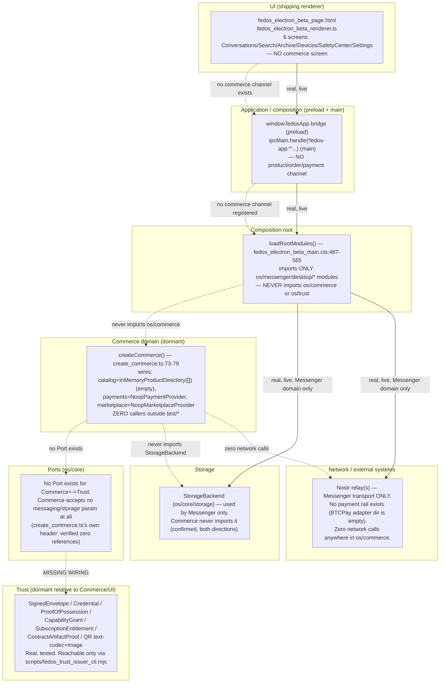

# Commerce Backend/Dataflow — As-Implemented

**Audited commit:** `4e2825cb1e08a03509cd6b7c6e708c9b496fcf65`.

> Nothing in `src/os/commerce/` or `src/os/trust/` is a "backend" in the network-service sense — both are local, in-process TypeScript libraries. This document is careful not to imply a server exists where there is only a local module.

## Layer model

## Per-transition detail

| Transition | Function/module | Input | Output | Authority | Persistence | Network side effect | Failure behavior |
|---|---|---|---|---|---|---|---|
| UI → Bridge | *(none — no commerce UI exists)* | — | — | — | — | — | N/A |
| Bridge → Composition root | `window.fedosApp` / `ipcMain.handle` | n/a | n/a | N/A — no commerce channel registered | N/A | N/A | N/A |
| Composition root → Commerce | `loadRootModules()` | dist module paths | `RootModules` (Messenger only) | N/A — `os/commerce` never imported | N/A | None | N/A (chain never starts) |
| Commerce catalog query | `listViewableProducts()` (`catalog/directory.ts:60-68`) | `products[]`, `actorPubkey`, `grants[]` supplied directly by caller (no query surface) | `Product[]` | Caller-supplied data only — no verification | None (in-memory array, no write method) | None | Pure function, no failure mode beyond normal TS type errors |
| Commerce → Payment | `productToPaymentRequest()` → `PlaceholderPaymentProvider.requestPayment()` (`commerce_bridge.ts:69-87`, `noop_payment.ts:214-268`) | `Product`, `buyerPubkey` | `PaymentDecision` | **None** — local non-cryptographic checks only (amount ≥ 0, no sensitive-substring metadata) | In-memory `Map` ledger, dies with process | **None — zero network calls** | Returns `rejected`/`unavailable`, never throws |
| Payment → Grant | `paymentDecisionToGrant()` (`commerce_bridge.ts:107-120`) | `PaymentDecision`, `buyerPubkey` | `PurchaseGrant` | Type-restricted: can never claim `source: "payment"` | None — returned to caller, nothing stores it | None | Returns `null` if decision isn't `accepted_placeholder` |
| Grant → Merchant notification | *(none exists)* | — | — | — | — | — | N/A — no Order/notification concept exists at all |
| Commerce ↔ Trust | *(none exists)* | — | — | — | — | — | N/A — zero cross-imports, enforced by `test/architecture_boundary_trust.test.ts` |
| Trust: issue/verify envelope | `issueFedosTrustSignedEnvelope()` / `verifyFedosTrustEnvelopeV1()` (`os/trust/envelope/`) | Payload + signing key | Signed/verified envelope | Real Schnorr signature verification | Whatever the CLI caller persists externally | None from the library | Verification failure returns a typed rejection, not a throw (per Trust's own README discipline) |
| Trust: QR encode/decode | `encodeFedosTrustEnvelopeToQrText()` / `decodeFedosTrustEnvelopeFromQrText()` (`os/trust/qr/`) | Signed envelope / QR text | QR text / structurally-parsed envelope (**not** cryptographically re-verified on decode — caller must call verify separately) | N/A — QR is transport only | None | None | Decode returns null/throws on malformed text; never auto-verifies |
| Messenger data path (for contrast — this IS live) | Double Ratchet + NIP-17 send/receive | Plaintext message | Ciphertext event | Ratchet session state | `StorageBackend` (local disk) | Nostr relay(s) | Standard messenger error handling (retry/backoff), out of scope for this audit |

## Where signatures are actually checked

Only inside `os/trust/` — `fedos_trust_envelope_verify.ts:54-107` and the corresponding possession/entitlement/contract-proof verify functions. **None of this is ever invoked from Commerce or the Desktop shell.** The one live entry point for Trust verification is the standalone CLI (`npm run trust:issuer`), not the packaged app.

## Where payment authority exists

**Nowhere that is authoritative.** See [PAYMENT-FLOW.md](PAYMENT-FLOW.md). The closest thing, `PlaceholderPaymentProvider`'s ledger, is explicitly self-documented as never representing a real payment.

## Where persistence happens

Only in the Messenger domain (`StorageBackend`, local disk, encrypted conversation/device state). **Commerce persists nothing** — `InMemoryProductDirectory` has no write method; `PlaceholderPaymentProvider`'s ledger is transient in-memory.

## Where network calls occur

Only Messenger ↔ Nostr relay(s), for message transport. **Zero network calls occur anywhere in `os/commerce` or `os/trust`** (Trust's CLI is local-process only; nothing in either domain imports `fetch`, a socket library, or an external SDK).

**BACKSIDE DATAFLOW: PASS** (faithfully shows the near-total absence of live wiring, which is the actual state of the system — nothing here should be read as describing a functioning backend, because none exists for commerce).
