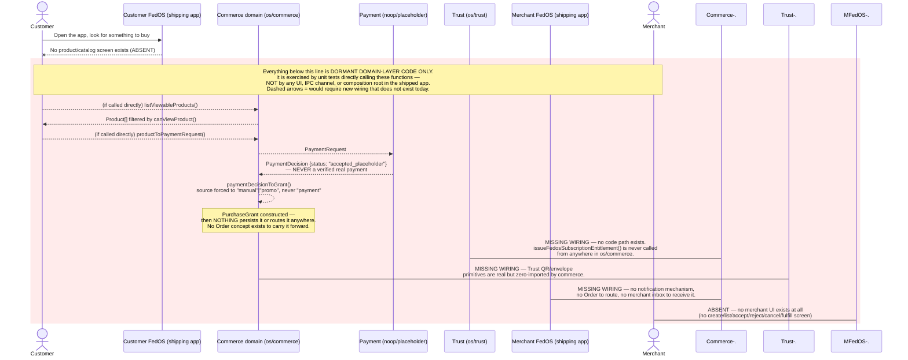
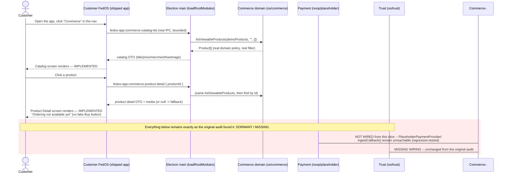

# Commerce End-to-End Swimlane — As-Implemented

**Audited commit:** `4e2825cb1e08a03509cd6b7c6e708c9b496fcf65`.
**Updated by:** Commerce Reachable Catalog + Product Surface Phase 1 arc. Customer discovery (Catalog → Product Detail) is now IMPLEMENTED and reachable from the real packaged FedOS Desktop app — see §"Phase 1 update" below. Everything after Product Detail (Order/Payment/Delivery/QR) remains exactly as dashed/not-wired as the original audit found it.

## Legend

- **Solid arrow** — IMPLEMENTED and reachable in the flow it's drawn in (may still be reachable only within the dormant domain layer's own unit tests — labeled explicitly where that's the case).
- **Dashed arrow** — NOT-YET-WIRED / PROPOSED. Never drawn to represent something that actually executes today.
- Lane order: Customer → Customer FedOS → Commerce (domain layer) → Payment → Trust → Merchant FedOS → Merchant. Messenger/Nostr is added only where it is actually involved (it is not, anywhere in this flow).

## Diagram

## What is actually solid (implemented) anywhere in this diagram

Only the two innermost domain-layer hops are real, working code:
1. `listViewableProducts()` → filtered `Product[]` (`catalog/directory.ts:60-68`, `catalog/policy.ts:61-85`)
2. `productToPaymentRequest()` → `PaymentRequest` → `PlaceholderPaymentProvider.requestPayment()` → `PaymentDecision` (`payment/commerce_bridge.ts`, `payment/noop_payment.ts`)
3. `paymentDecisionToGrant()` → `PurchaseGrant` (`payment/commerce_bridge.ts:107-120`)

All three are pure, in-process TypeScript functions, fully unit-tested (`test/commerce_*.test.ts`, `test/architecture_payment_provider_btcpay_readiness.test.ts` — all passing per this audit's `test:current` run), and **none is reachable from any UI, IPC channel, or composition root in the shipped Electron app.**

## What is entirely absent

- ~~Any UI screen for product discovery, product detail~~ — **UPDATED, see "Phase 1 update" below**: product discovery (Catalog) and Product Detail are now real, reachable screens. Order creation, payment, order confirmation, and merchant management screens remain entirely absent.
- The Order concept itself (no type exists anywhere).
- Any real payment rail (`payment/adapters/btcpay/` is a reserved, empty directory).
- Any wiring between Commerce and Trust (zero cross-imports in either direction, enforced by `test/architecture_boundary_trust.test.ts`).
- Any delivery mechanism (`DigitalAsset` type is dead code, zero consumers).

**E2E DIAGRAM: PASS** (as a faithful representation of current reality at the audited commit — the diagram above intentionally documents that snapshot and is left unmodified; the Phase 1 update below is additive, not a retroactive edit to the original diagram).

## Phase 1 update — Customer discovery is now IMPLEMENTED

**What changed vs. the original diagram above:** `loadRootModules()` now dynamically imports the real `os/commerce` barrel (`src/os/commerce/index.ts`, newly added to `tsconfig.beta-runtime.json`'s build allowlist) and calls the SAME real `listViewableProducts()` the original diagram already showed as "solid (implemented)" — the difference is this call is now reachable from the real Electron main process and IPC surface, not only from `test/commerce_*.test.ts`. `productToPaymentRequest()` / `paymentDecisionToGrant()` / the Payment lane are untouched — Phase 1 never imports or constructs a `PaymentProvider` of any kind (see `docs/commerce/PRODUCT-SURFACE-AUDIT.md`'s Phase 1 regression guard).

**CUSTOMER DISCOVERY (Catalog → Product Detail): IMPLEMENTED.**
