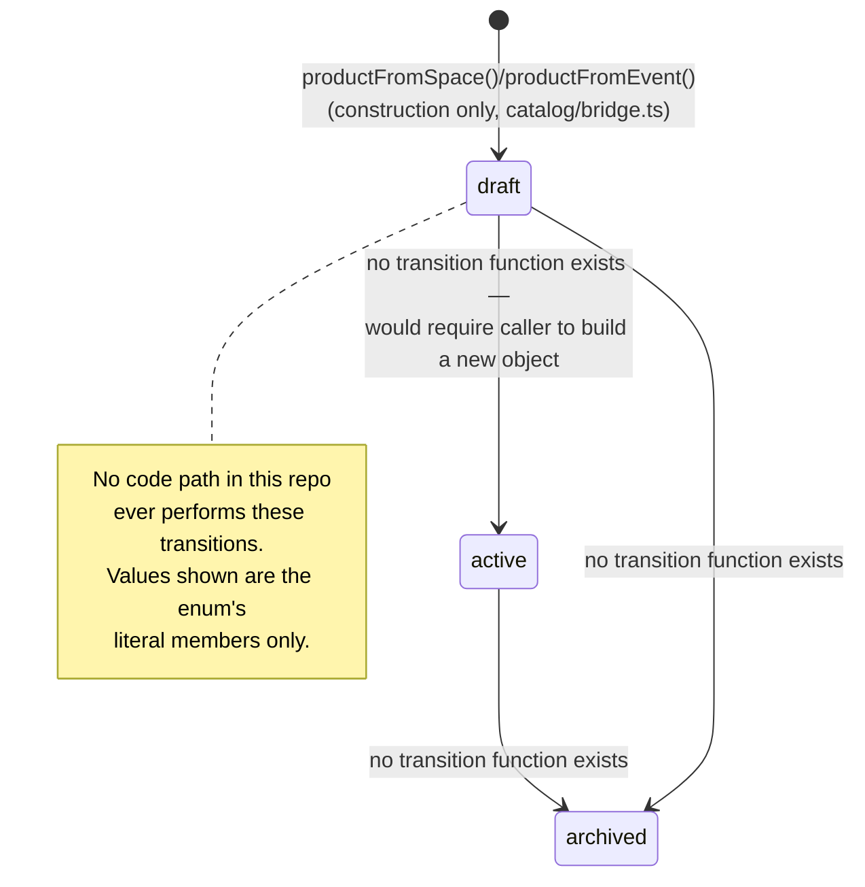
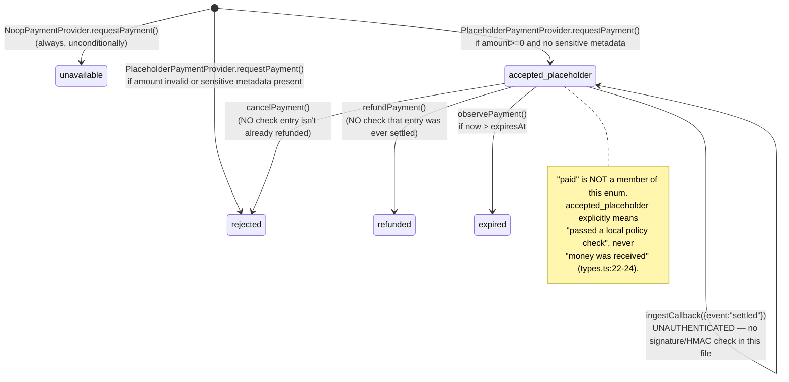

# Commerce State Machines — As-Implemented

**Audited commit:** `4e2825cb1e08a03509cd6b7c6e708c9b496fcf65`.

> None of the diagrams below represent a live, running state machine — they represent the *set of string-literal values* a type can hold, since **no explicit transition function/table exists for any of Product, Order, Payment, or Delivery** in this codebase. Where a diagram implies a transition, it is drawn only where a caller *could* legally construct that new value — never because a guarded transition function was found. This is stated per-diagram below.

## Product

**Implicit only.** `ProductStatus = "draft" | "active" | "archived"` (`catalog/types.ts:23`) is a plain string-literal enum. No function named anything like `transitionProduct`/`activateProduct`/`archiveProduct` exists anywhere in `src/os/commerce/`. A status change, if it ever happened, would require a caller to construct an entirely new `Product` object with a different `status` — there is no guarded mutation.

## Order

**Absent — no state machine, because no Order type exists at all.** `src/os/commerce/README.md:52-58` states explicitly: *"No Order... concept is defined anywhere in this capability."* There is nothing to diagram.

## Payment

**Implicit only.** `PaymentStatus = "unavailable" | "pending" | "accepted_placeholder" | "rejected" | "expired" | "refunded" | "error"` (`payment/types.ts:57-64`). `PlaceholderPaymentProvider`'s in-memory ledger (`noop_payment.ts:191`) mutates `entry.status` directly inside `observePayment`/`ingestCallback`/`cancelPayment`/`refundPayment`, with **no guard checking the entry's prior state** before mutating (e.g. `cancelPayment` doesn't verify the entry isn't already `refunded`; `refundPayment` doesn't verify it was ever settled).

## Delivery

**Absent — no Delivery concept exists anywhere in the repository.** Confirmed by the same README statement cited above, and independently: `DigitalAsset` (the closest artifact-delivery shape) has zero consumers repo-wide (dead code). There is nothing to diagram.

## Summary

| Machine | Explicit transition function? | Verdict |
|---|---|---|
| Product | No | IMPLICIT (bare enum field only) |
| Order | N/A | ABSENT (type doesn't exist) |
| Payment | No — ad hoc, unguarded ledger mutation | IMPLICIT, and unguarded even within its own dormant scope |
| Delivery | N/A | ABSENT (type doesn't exist) |

**STATE MACHINES: PARTIAL** — Product and Payment have implicit state via bare fields; Order and Delivery are entirely absent as concepts.
