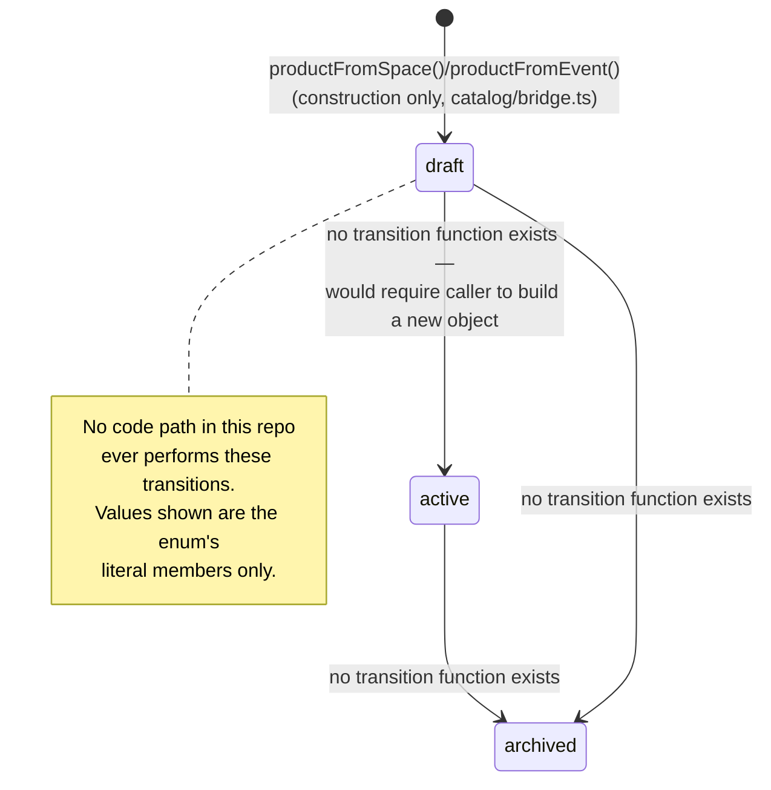
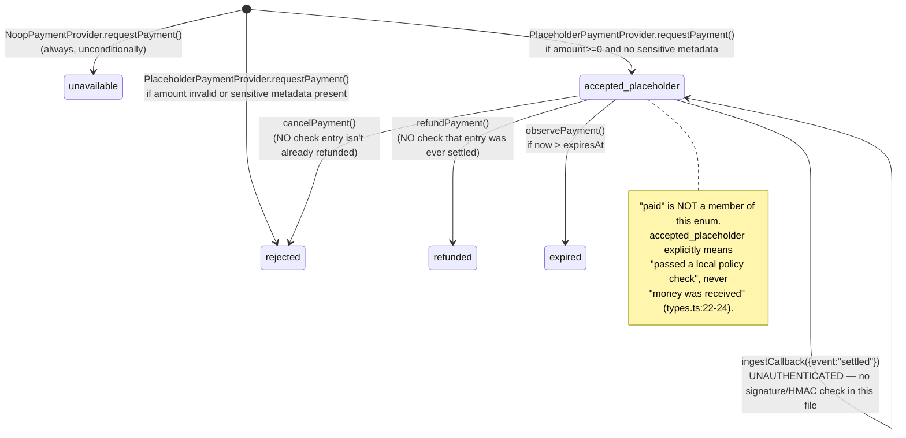

# Commerce State Machines — As-Implemented

**Audited commit:** `4e2825cb1e08a03509cd6b7c6e708c9b496fcf65`.

## Commerce E2E Completion arc update (current, additive)

**Order and Delivery are no longer absent — both are real, explicit, GUARDED state machines.** `src/os/commerce/order/order_state_machine.ts`'s `createOrder()`/`applyOrderAction()` and `src/os/commerce/delivery/delivery_state_machine.ts`'s `createDelivery()`/`applyDeliveryAction()` each return a discriminated `{ok: true, order|delivery} | {ok: false, code, reason}` result, checking BOTH an actor-kind allowlist (`AUTHORIZED_ACTOR_KINDS`, re-checked at runtime independent of the type system) and, for `"merchant"`/`"customer"` actors, an identity check (`actor.pubkey` must match the record's own buyer/seller pubkey) before any transition — the "no guarded mutation" critique below no longer applies to these two. Order legal states: `created → submitted → accepted → paid → fulfilling → delivered → completed` (plus `cancelled`/`rejected` off-ramps). Delivery legal states: `pending → fulfilling → delivered → completed`. Critically, `"paid"` and `"delivered"` are reachable ONLY via a re-verified `authoritative` evidence provenance (`payment_evidence`/`delivery_evidence` actor kinds) — never a bare `"customer"`/`"merchant"` claim, structurally enforced by the same actor-kind allowlist. See `docs/commerce/FEDOS-COMMERCE-END-TO-END.md`'s "Commerce E2E Completion arc update" for the real end-to-end verification, including three real composition-root bugs this arc's own real-Electron test run found (the composition root was checking the wrong discriminant field, `outcome` instead of `ok`, so every real order/delivery transition call was silently always rejected until fixed).

Product and Payment's descriptions below are unchanged and still accurate for the ORIGINAL dormant `PlaceholderPaymentProvider`/`NoopPaymentProvider` path. A separate, new `DeterministicLocalPaymentProvider` (`payment/local_simulator.ts`) now provides a real, guarded settlement path feeding Order's `"paid"` state — constructible only with `{ acknowledgeTestOnly: true }` and refusing `runtimeProfile: "production"` (TEST/LOCAL simulator only, never a real payment rail) — see the E2E doc above rather than this file for its own diagram, not yet added here.

> None of the diagrams below represent a live, running state machine — they represent the *set of string-literal values* a type can hold, since **no explicit transition function/table exists for any of Product, Order, Payment, or Delivery** in this codebase. Where a diagram implies a transition, it is drawn only where a caller *could* legally construct that new value — never because a guarded transition function was found. This is stated per-diagram below.

## Product

**Implicit only.** `ProductStatus = "draft" | "active" | "archived"` (`catalog/types.ts:23`) is a plain string-literal enum. No function named anything like `transitionProduct`/`activateProduct`/`archiveProduct` exists anywhere in `src/os/commerce/`. A status change, if it ever happened, would require a caller to construct an entirely new `Product` object with a different `status` — there is no guarded mutation.

## Order

**HISTORICAL — superseded, see the update note above.** At the original audited commit: absent, no state machine, because no Order type existed at all. `src/os/commerce/README.md:52-58` stated explicitly: *"No Order... concept is defined anywhere in this capability."* That README statement is now stale — a real, guarded Order state machine exists (see update note above).

## Payment

**Implicit only.** `PaymentStatus = "unavailable" | "pending" | "accepted_placeholder" | "rejected" | "expired" | "refunded" | "error"` (`payment/types.ts:57-64`). `PlaceholderPaymentProvider`'s in-memory ledger (`noop_payment.ts:191`) mutates `entry.status` directly inside `observePayment`/`ingestCallback`/`cancelPayment`/`refundPayment`, with **no guard checking the entry's prior state** before mutating (e.g. `cancelPayment` doesn't verify the entry isn't already `refunded`; `refundPayment` doesn't verify it was ever settled).

## Delivery

**HISTORICAL — superseded, see the update note above.** At the original audited commit: absent, no Delivery concept existed anywhere in the repository (confirmed by the same README statement, and independently: `DigitalAsset`, the closest artifact-delivery shape, had zero consumers repo-wide). A real, guarded Delivery state machine now exists (see update note above); `DigitalAsset` itself remains unused — Delivery did not reuse it.

## Summary

| Machine | Explicit transition function? | Verdict |
|---|---|---|
| Product | No | IMPLICIT (bare enum field only) — unchanged |
| Order | **Yes** — `applyOrderAction()`, actor-kind + identity checked | **REAL, GUARDED** (Commerce E2E Completion arc) |
| Payment | No — ad hoc, unguarded ledger mutation, in the ORIGINAL dormant provider | IMPLICIT/unguarded in `PlaceholderPaymentProvider`; a separate new `DeterministicLocalPaymentProvider` provides a real, guarded, TEST/LOCAL-only settlement path (see update note) |
| Delivery | **Yes** — `applyDeliveryAction()`, actor-kind + identity checked | **REAL, GUARDED** (Commerce E2E Completion arc) |

**STATE MACHINES: Order and Delivery now REAL and GUARDED; Product unchanged (IMPLICIT); Payment is IMPLICIT/unguarded in the original dormant provider, with a separate real, guarded, TEST/LOCAL-only path now also reachable.** See the update note at the top of this document.

---

## Commerce FINAL Closure Mega-Arc update (current, additive)

**Reputation attestation is not itself a state machine on a mutable record** (no `TradeCompletionAttestation`, once issued, is ever transitioned to a different state — it is issue-once, verify-many), but it is a real, guarded GATE keyed to Order's own state: `issueTradeCompletionAttestation()` (`src/os/commerce/reputation/reputation_issuance.ts`) accepts only an `orderId`, looks it up through a real `OrderRepository`, and rejects with `order_not_completed` unless `order.status === "completed"` — the identical terminal state `applyOrderAction({type:"complete"})` produces above. A second gate (`unauthorized_attestor`) requires the attesting pubkey to match the order's own buyer/seller side; a third (`duplicate_attestation`) prevents a second attestation by the same attestor for the same order, even with a fresh random salt. All three gates are real, tested, and independent of the UI. See `test/commerce_reputation_issuance.test.ts`.

**PersonaEpoch validity is itself a small time-windowed state check**, not a transition machine: `isPersonaEpochCurrentlyValid(epoch, atTimeUnixSeconds)` is `true` strictly inside `[validFrom, validUntil)` (with a small, explicit clock-skew tolerance), `false` otherwise — an attestation signed while an epoch was valid remains verifiably `VALID` after the epoch later expires (verification is independent of epoch *currency*, only epoch *validity at signing time* matters), but a NEW attestation attempt under an already-expired epoch is correctly rejected. Epoch rollover (`buildEpochCarryOverStatement`) is a one-directional, predecessor-signed, explicitly-linkable-if-used statement — never a silent identity carry-over. See `test/commerce_reputation_persona_epoch.test.ts` / `test/commerce_reputation_issuance.test.ts`'s own "epoch rollover" and "OLD EPOCH" describe blocks.

**STATE MACHINES (Commerce FINAL Closure Mega-Arc): Order/Delivery unchanged (REAL, GUARDED); Reputation issuance is a real, guarded GATE on Order's own terminal state, not a machine of its own; PersonaEpoch validity is a real, tested time-window check.**
