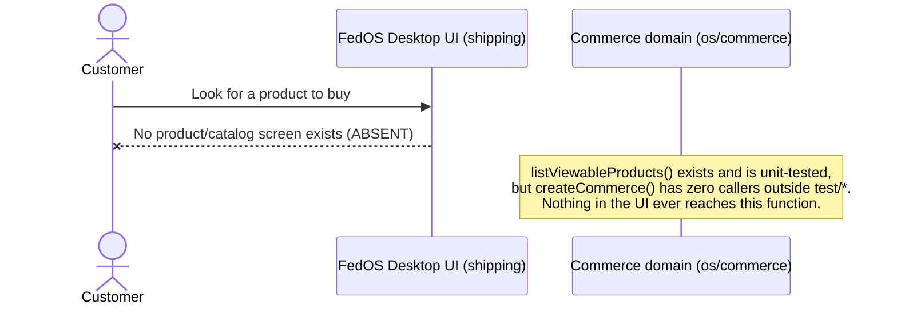

# Customer Commerce Flow — CURRENT IMPLEMENTED FLOW ONLY

**Audited commit:** `4e2825cb1e08a03509cd6b7c6e708c9b496fcf65`. See [ACTOR-MAP.md](ACTOR-MAP.md) for actor definitions.

> This document describes ONLY what a customer can actually do today. It does not describe intended, planned, or type-level-only behavior as if it were reachable. Where the code models something that no UI/IPC path reaches, that is stated explicitly as **DORMANT**, never as "implemented."

## Headline answer

**A FedOS customer cannot discover a product, place an order, or pay a merchant, in the shipping application.** No such screen, IPC channel, or composition-root wiring exists. This was independently confirmed by Agent U (UX surface trace) and is consistent with Agent C (Commerce domain trace: zero callers of `createCommerce()` outside tests).

## Question-by-question findings

### How does a customer discover a product?
**Not possible in the running app.** The shipping renderer (`packages/fedos-desktop-electron-spike/src/fedos_electron_beta_page.html`) has exactly six navigation surfaces: Conversations, Search, Archive, Devices, Safety Center, Settings — no product/catalog surface exists (full div enumeration, lines 148-321).

A *pure function* discovery mechanism exists in the dormant Commerce domain: `listViewableProducts(products, actorPubkey, grants)` (`src/os/commerce/catalog/directory.ts:60-68`), filtered through `canViewProduct()` (`catalog/policy.ts:61-85`). It requires a caller to supply the full product array directly (there is no query/search/index) — it is not reachable from any UI or IPC channel.

### Where does Product live?
`src/os/commerce/catalog/types.ts:33-52` — see field table in [PRODUCT-SURFACE-AUDIT.md](../commerce/PRODUCT-SURFACE-AUDIT.md). This type is real and well-formed, but the directory holding instances of it (`InMemoryProductDirectory`) defaults to an **empty array** at the one composition point that constructs it (`create_commerce.ts:75`), and nothing in the shipped app ever constructs a non-empty one.

### What fields does Product actually have?
`id`, `kind`, `title`, `description?`, `creatorPubkey`, `priceCents`, `currency`, `status`, `visibility`, `linkedSpaceIds`, `linkedEventIds`, `assetIds`. No image/video/gallery/sample field. Full detail in the Product Surface Audit.

### Can Customer view: title / description / price / currency / stock / merchant / image / gallery / video / downloadable sample?
**None of these — there is no product detail screen in the shipping app at all** (Agent U: zero commerce-related screens found by full enumeration of the shipping HTML/renderer/preload). Field-by-field, even if a screen existed:
- title/description/price/currency/merchant(creatorPubkey): present as `Product` fields, so renderable *if* a UI existed. Not currently rendered anywhere reachable.
- stock/inventory: **ABSENT from the type entirely** — no `Product` field represents quantity/inventory of any kind.
- image/gallery/video/downloadable sample: **ABSENT to MODEL-ONLY** — see [PRODUCT-SURFACE-AUDIT.md](../commerce/PRODUCT-SURFACE-AUDIT.md) §Media for the full classification (media lives only in a sibling dead-code subsystem, `AssetMetadata`, never on `Product` itself).

### What action creates an Order?
**No Order concept exists at all.** `src/os/commerce/README.md:52-58` states this explicitly: *"No Order, Support (ticketing), Delivery, or Seller State concept is defined anywhere in this capability."* Confirmed by repo-wide grep for `PurchaseOrder|OrderRecord|OrderState|OrderStatus|class Order|interface Order|type Order` — zero matches.

The closest concept is `PurchaseGrant` (`catalog/types.ts:78-86`) — but per its own doc comment, it records only the *result* of an already-decided external entitlement (a manual gift, a settled payment elsewhere, a promo code). Nothing in the codebase creates one from an actual customer action in the running app.

### Who signs it?
N/A — there is no Order object, and `PurchaseGrant` is never signed by anyone (it is a plain data object; no signature field exists on it, and no Trust primitive is ever applied to it — confirmed zero cross-imports between `os/commerce` and `os/trust` in either direction).

### Where is it stored?
Nowhere durable. `InMemoryProductDirectory` has no write method at all (Agent C, §11) and `PlaceholderPaymentProvider`'s ledger is an in-memory `Map` that dies with the process.

### How does it reach Merchant?
It doesn't — there is no notification mechanism, no Order concept to route, and (independently) the merchant has no inbox UI to receive anything into (see [MERCHANT-COMMERCE-FLOW.md](MERCHANT-COMMERCE-FLOW.md)).

### What happens before payment?
Nothing reachable. In the dormant domain layer only: `canRequestPaymentForProduct(product)` (`payment/commerce_bridge.ts:40-53`) is a pure eligibility check (`status === "active"` and non-negative price), then `productToPaymentRequest()` (commerce_bridge.ts:69-87) builds a `PaymentRequest`. Neither is called by anything reachable from the shipped app.

### What happens after payment?
There is no "after payment," because there is no "payment" — see [PAYMENT-FLOW.md](PAYMENT-FLOW.md). The closest terminal state, `accepted_placeholder`, is explicitly documented as never meaning a real payment was received (`payment/types.ts:22-24`).

### What does Customer receive?
Nothing — no receipt, confirmation, credential, or QR is ever generated by any reachable code path (Agent U: no order-confirmation/receipt screen exists anywhere in the shipping app; Agent P: QR generation code exists only in `os/trust/qr/`, used nowhere near commerce).

## Flow diagram — what actually happens (nothing, past discovery-in-theory)

## CURRENT IMPLEMENTED FLOW — summary

| Step | Status |
|---|---|
| Discover product | ABSENT (no UI); DORMANT pure function exists in domain layer |
| View product detail | ABSENT |
| Create order | ABSENT (no Order concept exists at all, in UI or domain) |
| Merchant notified | ABSENT (no mechanism) |
| Payment requested | ABSENT (no UI); DORMANT pure function exists in domain layer |
| Payment confirmed | ABSENT (no "paid" state exists anywhere in the codebase) |
| Receipt/credential/QR received | ABSENT |

**ACTUAL CUSTOMER FLOW: ABSENT** (see final report for the formal classification).
