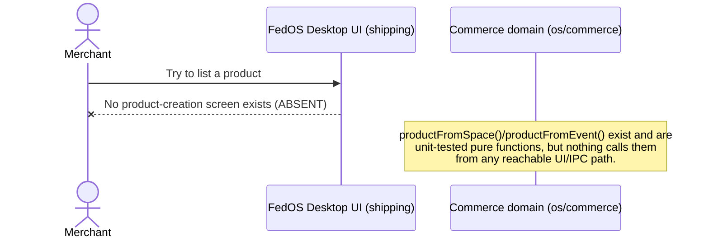

# Merchant Commerce Flow — CURRENT IMPLEMENTED FLOW ONLY

**Audited commit:** `4e2825cb1e08a03509cd6b7c6e708c9b496fcf65`. See [ACTOR-MAP.md](ACTOR-MAP.md) for actor definitions.

## Headline answer

**A FedOS merchant cannot list a product, receive an order, or confirm a payment, in the shipping application.** There is no merchant UI, no Order inbox, and no reachable path from the domain-layer types that model creator/product concepts.

## Question-by-question findings

### How does merchant create/list Product?
No UI action exists (Agent U: full enumeration of the shipping app's screens found zero create/list-product surface). In the dormant domain layer, a `Product` can only be **constructed** in two ways, neither of which publishes/persists/lists anything:
- `productFromSpace(space, options)` (`catalog/bridge.ts:51-66`) — builds a **draft** `Product` from a Stage-9 "Space" (a Reddit-style board concept), defaulting `creatorPubkey` to the space's first owner.
- `productFromEvent()` (`catalog/adapters/nostr/bridge.ts`) — builds a draft `Product` from a Nostr event.

Both are pure, side-effect-free construction functions. Neither is called from any reachable code path.

### How are price and terms defined?
`Product.priceCents` / `Product.currency` (`catalog/types.ts:40-41`) — plain numeric/string fields, explicitly **display metadata only, no charging** (per the type's own doc comment). No "terms" field exists on `Product` at all.

### How does merchant receive Order?
Not possible — no Order concept exists anywhere in the repository (see [CUSTOMER-COMMERCE-FLOW.md](CUSTOMER-COMMERCE-FLOW.md)), and independently there is no merchant-facing inbox/notification UI (Agent U confirmed zero such screen).

### How can merchant: accept / reject / cancel / fulfill? Which of those exist today?
**None exist.** Agent U's UX inventory, item by item:

| Capability | Status | Evidence |
|---|---|---|
| Create/list product | ABSENT | No screen in `fedos_electron_beta_page.html` |
| Receive order (inbox) | ABSENT | No marketplace/order screen; `NoopMarketplaceProvider` is a permanent no-op default with zero UI consumers |
| Accept | ABSENT | No affordance anywhere |
| Reject | ABSENT | No affordance anywhere |
| Cancel | ABSENT | No affordance anywhere |
| Fulfill | ABSENT | No affordance anywhere |

There is no distinct "merchant mode" or persona anywhere in the shipping renderer or preload bridge — FedOS Desktop has exactly one operating mode (secure messenger).

### How does merchant know payment is confirmed?
There is no mechanism, because there is no "confirmed payment" state — see [PAYMENT-FLOW.md](PAYMENT-FLOW.md). `PaymentStatus` has no `"paid"` value at all (`payment/types.ts:57-64`).

### What evidence is authoritative?
None exists for payment. The only near-adjacent state, `accepted_placeholder`, is produced entirely inside `PlaceholderPaymentProvider.requestPayment()` (`payment/noop_payment.ts:214-268`) by a purely local, non-cryptographic check (non-negative amount + no sensitive-substring metadata) — it is explicitly documented to mean "passed a policy check," never "money moved" (`payment/types.ts:22-24`). No merchant-side verification of any kind is wired to it, because nothing routes it to a merchant at all.

### Can merchant manually mark paid?
**No live affordance exists** — Agent U confirmed no button/IPC channel for this in the shipping app. However, worth flagging for future design discipline: the **type system already carries the shape** for a non-payment-verified acceptance path. `PurchaseGrantSource = "manual" | "payment" | "promo"` (`catalog/types.ts:71`), and `paymentDecisionToGrant()` (`payment/commerce_bridge.ts:94-120`) defaults new grants to `source: "manual"`, explicitly because *"this boundary never verifies a real payment, so `'payment'` is not offered here"* (commerce_bridge.ts:12-14, 94). This is dormant code, not a live policy violation — but if Commerce is ever wired up, this is exactly the seam that must stay gated so a manual/AI/customer claim can never masquerade as verified payment evidence.

### Expected FedOS policy: AI/customer claim must NOT be authoritative payment proof. Verify against actual code.
**Verified, and upheld — but only because the whole payment path is inert, not because of an active authorization control.** Concretely:
- `paymentDecisionToGrant()` is *structurally* prevented from ever emitting `source: "payment"` — the type `PlaceholderGrantSource = Extract<PurchaseGrantSource, "manual" | "promo">` (commerce_bridge.ts:90) excludes `"payment"` at the type level.
- Repo-wide grep for a constructed value `source: "payment"` returns zero hits anywhere in `src/`.
- `PlaceholderPaymentProvider.ingestCallback()` (noop_payment.ts:295-309) will accept an **unauthenticated** `{paymentId, event: "settled"}` payload from any caller with no signature/HMAC check *inside this file* — the interface doc (`types.ts:214-219`) says a real implementation "MUST verify any callback signature/HMAC itself," but the placeholder implementation does not, because it is dev/test scaffolding, not a hardened adapter.
- **Net assessment:** nothing currently lets an AI/customer claim be treated as authoritative payment proof — but that is a byproduct of the payment/commerce path being completely unreachable from the shipped app, not evidence of a working authorization boundary. If Commerce/Payment is ever wired into a live UI, this gap (`ingestCallback` accepting unauthenticated settlement events) would need to be closed before any real money-adjacent action depends on it.

### What does merchant deliver? Physical item? Digital item? Credential? Entitlement? QR? Arbitrary delivery artifact?
**None of these are ever delivered, because there is no delivery mechanism of any kind.** The closest concept, `DigitalAsset` (`catalog/types.ts:58-68`: `storageRef`, `filename?`, `sizeBytes?`, `checksum?`), is defined but has **zero consumers anywhere in the repository** — not re-exported from the commerce barrel (`index.ts`), never instantiated, never read. It is dead code, not a working digital-delivery path. `storageRef` is explicitly documented as "an opaque storage pointer... not resolved or fetched in this stage" (types.ts comment).

## Flow diagram — what actually happens (nothing, past draft-construction-in-theory)

## CURRENT IMPLEMENTED FLOW — summary

| Step | Status |
|---|---|
| Create/list product | ABSENT (UI); DORMANT pure construction functions exist |
| Define price/terms | Fields exist on `Product` (`priceCents`/`currency`); no "terms" field; no UI to set them |
| Receive order | ABSENT (no Order concept, no inbox UI) |
| Accept/reject/cancel/fulfill | ABSENT (no affordance of any kind) |
| Know payment is confirmed | ABSENT (no "paid" state exists) |
| Manual mark-paid affordance | ABSENT in UI; type-level seam exists in dormant code, correctly excludes `source: "payment"` |
| Deliver digital/physical/credential/QR | ABSENT (no delivery mechanism; `DigitalAsset` type is dead code) |

**ACTUAL MERCHANT FLOW: ABSENT** (see final report for the formal classification).
