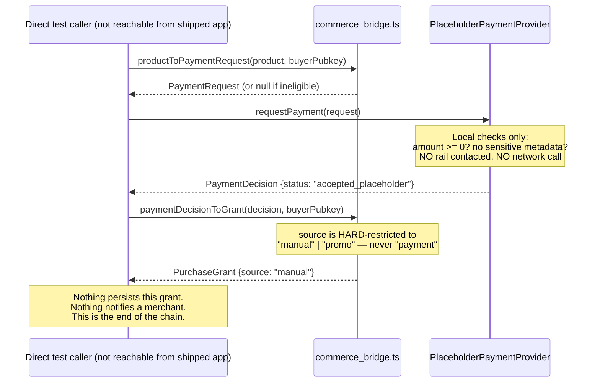

# Payment Flow — CURRENT IMPLEMENTED FLOW ONLY

**Audited commit:** `4e2825cb1e08a03509cd6b7c6e708c9b496fcf65`. See [ACTOR-MAP.md](ACTOR-MAP.md).

## Headline answer

**There is no "paid" state anywhere in this codebase, and no real payment rail is integrated (BTCPay, Stripe, Lightning, or otherwise).** The payment module is explicitly self-documented as inert scaffolding, unreachable from the shipped Electron app.

## Who requests payment?

Nobody in the running app — no UI/IPC path reaches it (Agent U). In the dormant domain layer: `productToPaymentRequest(product, buyerPubkey, options)` (`src/os/commerce/payment/commerce_bridge.ts:69-87`) builds a `PaymentRequest` from a `Product`, gated by `canRequestPaymentForProduct()` (commerce_bridge.ts:40-53).

## What is PaymentProvider?

An interface (`payment/types.ts`) with methods `getStatus()`, `requestPayment()`, `observePayment()`, `ingestCallback()`, `cancelPayment()`, `refundPayment()`. Two implementations exist, both stubs, both in `payment/noop_payment.ts`:

| Implementation | Behavior |
|---|---|
| `NoopPaymentProvider` (noop_payment.ts:135-173) | `getStatus()` → `{available: false}`; `requestPayment()` **always** → `{status: "unavailable", allowed: false}`; `ingestCallback()` **always** → `null`. Never produces any payment state. |
| `PlaceholderPaymentProvider` (noop_payment.ts:190-349) | In-memory `Map` ledger, "does nothing: no rail, wallet, or checkout session is contacted" (own doc comment). `requestPayment()` can return `accepted_placeholder` if amount ≥ 0 and no sensitive-looking metadata is present — synchronously, with no external confirmation of any kind. |

## What concrete adapters exist?

**None.** `payment/adapters/btcpay/` contains only a README (`payment/adapters/btcpay/README.md:1-25`) that states outright: *"No BTCPay adapter, SDK dependency, or server integration exists in this repository today — this directory is empty except for this file."* No `fetch`, socket, or external SDK import appears anywhere under `src/os/commerce/payment/`.

One test file, `test/architecture_payment_provider_btcpay_readiness.test.ts` (10 tests, confirmed passing in this audit's `test:current` run), exercises the `PaymentProvider` *interface contract* against the placeholder implementation — it is a shape/readiness test, not evidence of a real BTCPay integration.

## How is payment status represented?

`PaymentStatus` (`payment/types.ts:57-64`), the only such enum in the module:
```ts
"unavailable" | "pending" | "accepted_placeholder" | "rejected" | "expired" | "refunded" | "error"
```
A second, narrower union, `PaymentEvidence.status` (types.ts:170), used only for terminal/settlement-adjacent reads: `"settled" | "expired" | "refunded" | "error"`.

**No `"paid"`, `"disputed"`, `"processing"`, or `"chargeback"` state exists anywhere.** This was confirmed exhaustively by grep across the payment module.

## What is authoritative for PAID?

**Nothing — there is no PAID state to be authoritative for.** The closest concept, `accepted_placeholder`, is set exclusively inside `PlaceholderPaymentProvider.requestPayment()` (noop_payment.ts:257-263) the instant a `PaymentRequest` passes two purely local, non-cryptographic checks: non-negative finite amount, and no metadata value matching a hardcoded sensitive-substring list. This is documented explicitly (`payment/types.ts:22-24`): *"`accepted_placeholder` means 'this request passed the boundary's policy check', NEVER 'a payment was received/settled'."*

Even if this state were reached, it cannot become a real grant: `paymentDecisionToGrant()` (commerce_bridge.ts:107-120), the only function in the repo turning a `PaymentDecision` into a `PurchaseGrant`, is type-restricted to `PlaceholderGrantSource = Extract<PurchaseGrantSource, "manual" | "promo">` (commerce_bridge.ts:90) — it can structurally never emit `source: "payment"`.

## Can user/customer/merchant lie about payment state? What prevents that?

**Yes, trivially, by construction, within the dormant module itself** — there is no verification step between "caller calls `requestPayment()`" and "ledger says `accepted_placeholder`." `ingestCallback()` (noop_payment.ts:295-309) will also flip a ledger entry to `"accepted_placeholder"` given an unauthenticated `{paymentId, event: "settled"}` payload — with zero signature/HMAC check *inside this file* (the interface doc, `types.ts:214-219`, says a real implementation "MUST verify any callback signature/HMAC itself"; the placeholder does not, being dev/test scaffolding).

**What actually prevents this from mattering:** not a control inside the payment code — the fact that *nothing downstream ever consumes this module's output as a real payment*. `commerce_bridge.ts:15` and `noop_payment.ts:20-21` both state the module is "inert scaffolding, not reachable from the shipped Electron app." No caller in the shipped app can even reach `requestPayment()`/`ingestCallback()` to exploit this — the risk is real *in the code*, but currently unreachable *in the product*.

## What happens on: pending / paid / failed / expired / refunded / disputed?

| State | Exists? | Behavior |
|---|---|---|
| pending | Yes (`PaymentStatus`) | Never actually returned by either implementation in the traced code paths — `requestPayment()` resolves synchronously to a terminal status. |
| **paid** | **No — does not exist as a state** | N/A |
| failed / error | Yes (`"error"`) | Present in the enum; not exercised in the traced happy path. |
| rejected | Yes | `requestPayment()` returns `rejected` if amount is invalid or sensitive metadata is present. |
| expired | Yes | `PaymentEvidence.status` can be `"expired"`; test coverage exists (`architecture_payment_provider_btcpay_readiness.test.ts`, "5b. expired: an accepted payment observed after its expiresAt elapses reports expired evidence"). |
| refunded | Yes | `refundPayment()` (noop_payment.ts) sets `entry.status = "refunded"` — with **no check that the entry was ever settled first** (no guard against refunding a never-accepted payment). |
| disputed | **No — does not exist as a state** | N/A |

## Payment State Machine

**No explicit state machine exists** — no function anywhere enumerates or validates legal transitions between `PaymentStatus` values. `PlaceholderPaymentProvider`'s ledger mutates `entry.status` directly and ad hoc inside `observePayment`/`ingestCallback`/`cancelPayment`/`refundPayment`, with no guard that the entry was in an eligible prior state before mutating (e.g. `cancelPayment` doesn't check the entry isn't already `"refunded"`). See [COMMERCE-STATE-MACHINES.md](COMMERCE-STATE-MACHINES.md) for the full diagrammed assessment.

## Sequence — what actually happens if the dormant code were called directly (bypassing the fact that nothing calls it)



## ACTUAL PAYMENT FLOW: ABSENT

No real settlement rail exists, no "paid" state exists, and the entire module is unreachable from the shipping application.
